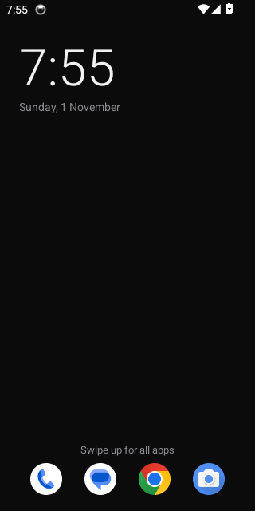
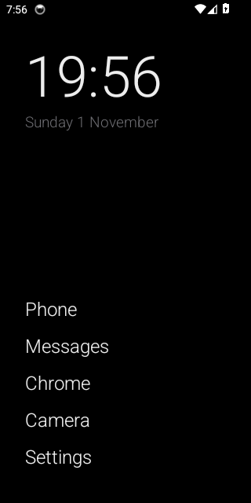
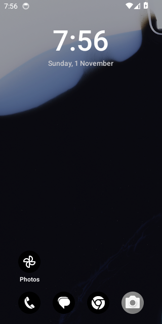
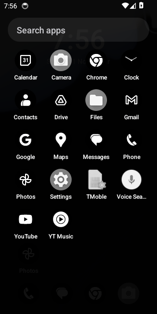

# shapeyourphone

Your Android phone, shaped by an AI agent. Not a custom ROM, and no root needed.
It runs on the Android you already have, over adb, and **every change can be undone**.

You tell your agent (Claude Code, Claude Desktop, Codex, Gemini CLI…) how you
want your phone. It cleans out bloat, tightens privacy, tunes settings, and
designs your home screen. It remembers what you asked for, so the next request
builds on the last one instead of starting over.

> **Status: v0.1.** Every CI run drives the real CLI over adb against Android
> 8, 11, 14 and 16 emulators: debloat, undo, install the launcher, time rules,
> the pause screen, full restore. It has **not been tested on physical phones
> yet**, and phone makers' Android versions differ, so
> [device reports](https://github.com/rachitkj/shapeyourphone/issues/new?template=device-report.yml)
> are very welcome.

| Default | Minimal text | Wallpaper + evening rule | Drawer |
|---|---|---|---|
|  |  |  |  |

## Get started

**1. Turn on USB debugging.** Settings → About phone → tap *Build number* 7
times → Developer options → *USB debugging*. Plug the phone in and tap *Allow*.
You also need adb (`brew install android-platform-tools`,
`winget install Google.PlatformTools`, or `apt install adb`) and Python 3.9+.

**2. Pick how you want to talk to it.**

| You use | Do this |
|---|---|
| Claude Code, Codex, Gemini CLI | `git clone https://github.com/rachitkj/shapeyourphone && cd shapeyourphone`, open your agent there and say **"Follow PROMPT.md"**. |
| Claude Desktop or another MCP app | `pipx install git+https://github.com/rachitkj/shapeyourphone`, then add the server below and ask Claude to help with your phone. |
| Just a terminal | `pipx install git+https://github.com/rachitkj/shapeyourphone`, then `shape doctor`, `shape scan`, `shape --help`. |

MCP config (Claude Desktop → Settings → Developer → Edit Config):
```json
{"mcpServers": {"shapeyourphone": {"command": "shape-mcp"}}}
```
Every tool that changes the phone returns a preview first, and only acts when
called again with `owner_approved: true`.

## What a session looks like
```
you:   my phone is full of junk and I waste too much time on Instagram
agent: shape scan → 14 preinstalled apps you can switch off (Meta App Manager,
       Samsung TV Plus, …), nothing you use. Here's the plan. OK?
you:   yes, but keep Samsung Notes
agent: shape keep com.samsung.android.app.notes · shape apply … --yes   ✓ 13 done
       Want a calmer home screen? I can hide Instagram on weekdays 9–18 and
       show a 10-second pause before it opens the rest of the time.
you:   do it
agent: shape launcher hide Instagram --days weekdays --from 09:00 --to 18:00 --yes
       shape launcher pause Instagram --seconds 10 --yes                     ✓
       (noted in your preferences, so next time I remember)
```

## What it does

**Cleanup and privacy**
- `init` saves a full backup before anything changes.
- `scan` and `plan` use tiered bloat lists (safe / recommended / optional) for Google, Meta, Samsung, Xiaomi, OPPO/OnePlus/realme, vivo, Motorola and carriers. Each entry says in plain words what you'd lose.
- `privacy` shows who can use your camera, mic, location and contacts, plus accessibility services, notification readers and device admins.
- `tweak` covers animations, dark mode, font size, screen timeout, ad-blocking Private DNS, per-app notifications and background limits.

**A home screen that rebuilds itself to your taste** ([config reference](docs/launcher-config.md))
- A tiny launcher with no dependencies. Everything about it comes from one JSON config: theme, widgets (clock, apps, search, next calendar event), dock, drawer and gestures.
- Changes by name, live, with no reinstall: `shape launcher hide Instagram --from 22:00 --to 07:00`, `shape launcher dock Phone WhatsApp Camera`, `shape launcher theme --icons mono`. Every version is kept, so `launcher rollback` always works.
- **Time rules** ("work mode 9–18"), **search-only** apps, and a **pause screen** before distracting apps that never opens them by itself.
- The launcher only accepts commands from adb, so other apps on the phone can't change it.

**Memory, safety and new phones**
- `preferences.md` per phone is your wishes in plain words. The agent reads it before every session and keeps it current. It stays on your computer and is never committed.
- It never touches core Android, telephony, the stock launcher (which also provides recents and gestures), or packages known to bootloop. It also protects whatever *this* phone depends on: its keyboard, WebView provider, camera, dialer and SMS apps, accessibility tools, device admins, and anything you said to keep.
- Every change is checked on the phone and logged with its undo. Use `undo <id>`, `restore` for everything, or the generated `restore.sh` / `restore.ps1`, which need no Python.
- `drift` and `reapply` catch changes a system update quietly reverted. `clone --from <old phone>` sets a new phone up the same way.
- `suggest` reads real usage, with your permission, and proposes what to put in reach, pause or hide. It only suggests.

## What it can't do (without root)
It can't change the status bar, quick settings or lock screen, and it can't remove Google Play services. On Fire OS and some phone makers' Android versions, a third-party launcher can't become the home screen.

## Layout
```
shape/         Python toolkit + MCP server (stdlib only)   PROMPT.md   the agent's playbook
shape/data/    bloat lists, protected packages            docs/       launcher config reference
launcher/      Android launcher (Kotlin, no deps)          config/     default + example home screens
tests/         fake-phone tests, emulator e2e, vectors     scripts/    release signing setup
```

## Developing
- Python: `python3 -m unittest discover -s tests -t tests`
- Launcher: `cd launcher && ./gradlew testDebugUnitTest assembleDebug` (JDK 17+ and the Android SDK)
- Releases: run `scripts/make-release-key.sh` once, then `git tag v0.1.0 && git push origin v0.1.0`. CI builds a signed `shape-launcher.apk`, and `shape launcher install` downloads it.

See [CONTRIBUTING](CONTRIBUTING.md) · [SECURITY](SECURITY.md) · [CHANGELOG](CHANGELOG.md).
Inspired by [cleanyourtv](https://github.com/Gathin23/cleanyourtv). MIT licensed.
